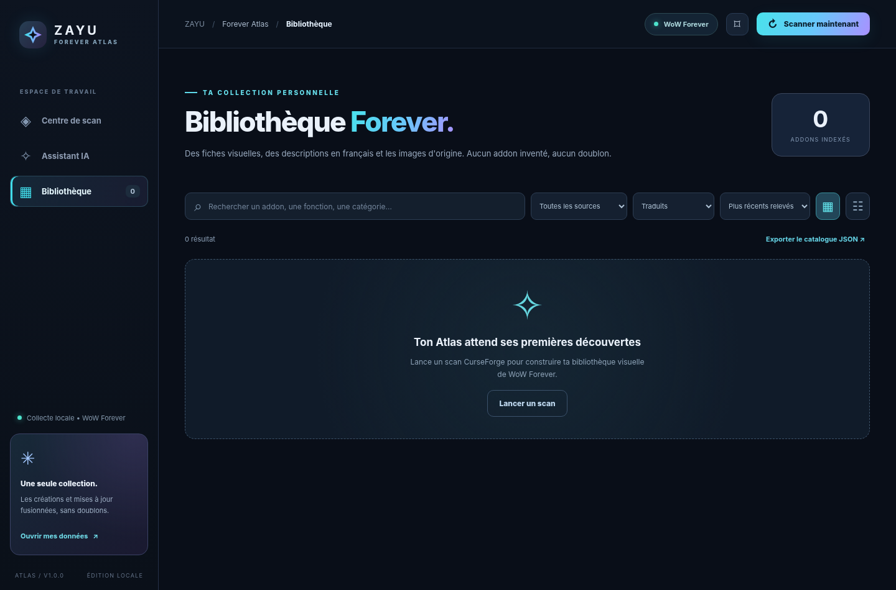
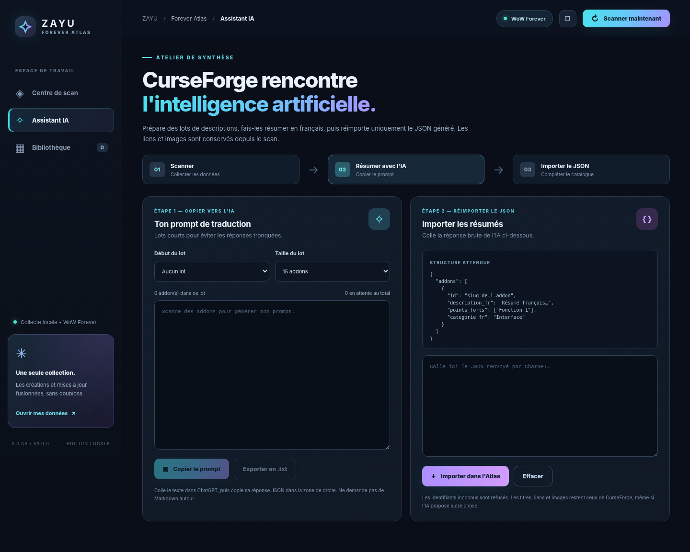

# ZAYU Forever Atlas

**A visual World of Warcraft addon discovery companion for Windows.**

> **Project status:** v1.0.1 development prototype · free, personal, non-commercial · independently developed and not affiliated with CurseForge, Overwolf, Blizzard Entertainment, or addon authors.

ZAYU Forever Atlas is a desktop companion for discovering, comparing, and understanding World of Warcraft addons. It brings together project details in a searchable visual library, with a particular focus on **French-speaking players** and optional AI-assisted summaries.

**CurseForge remains the original source of project information.** Each addon entry is intended to link directly to its author’s CurseForge project page. Atlas is not a mod-hosting service, an addon distribution platform, or an installer.

## Interface preview

### Visual addon library

### French-language AI summary assistant

*These are prototype interface screenshots with illustrative or empty-state data; they do not show a completed live API import.*

## Main features

- **Discover projects:** explore addon information, including recently updated projects and new releases where supported by the data source.
- **Compare and organize:** combine overlapping results by project identifier and browse titles, project links, descriptions, icons, and available screenshots.
- **Explore visually:** search, filter, switch between card and list views, and inspect image galleries where available.
- **Understand addons in French:** optionally prepare structured prompts for an external AI assistant, then manually import the resulting French summaries as JSON.
- **Retain source attribution:** preserve original project titles, URLs, and author links; the AI workflow is designed to summarize rather than invent addon information.

The interface is built using **Python, pywebview, HTML, CSS, and JavaScript**. The current prototype runs locally on Windows.

## CurseForge API integration — access requested

We are seeking approval to use the **official CurseForge third-party API** as the authorized source for:

- project identifiers, names, descriptions, and original CurseForge URLs;
- supported World of Warcraft versions and update information;
- project icons and screenshots, when made available by the API;
- paginated addon discovery with reasonable request volumes.

The proposed integration is **user-initiated and rate-conscious**. We intend to respect API limits, platform terms, and author attribution. Some website sorting options may not have exact API equivalents; Atlas will distinguish those cases rather than claim otherwise.

**Development status:** the prototype currently includes experimental browser-based discovery and an optional, manually initiated Chrome capture/import workflow for pages users can normally access. Those methods can encounter access restrictions and are **not** presented as the finished API integration. A working, authorized API workflow is the objective of this application request.

**Data use requires clarification:** Atlas is designed around a user-local catalog. We are requesting guidance or explicit authorization before enabling persistent storage of API-derived metadata or passing API-derived descriptions to external AI services. We will adapt or disable functions that are not permitted. API credentials will never be committed to this repository.

Atlas **does not download, redistribute, mirror, or host addon files**. Any future distribution functionality would require the relevant creator and platform permissions.

## Audience and business model

- **Users:** World of Warcraft players, particularly French-speaking players researching addons.
- **Use case:** personal discovery, organization, comparison, and understanding.
- **Monetization:** none. There are no ads, subscriptions, donations, affiliate links, or software sales planned.
- **Creators:** original addon authors keep ownership and attribution; Atlas directs users to their original CurseForge pages.

## Prototype availability

The current desktop build is a development prototype requiring **Windows, Python 3.11+, and Edge WebView2**. This GitHub repository presently serves as the project's public technical overview for the CurseForge API application; it is **not** a published production release.

The UI and local JSON workflow have been tested using illustrative data. Live metadata retrieval and an end-to-end authorized API integration still require validation and API approval.

## Development priorities

1. Obtain authorization for API access and clarify the permitted handling of metadata, screenshots, and AI summaries.
2. Implement and validate authorized API-based discovery in the desktop application.
3. Improve source attribution, reliability, update tracking, and duplicate detection.
4. Refine the French visual catalog and release only features compatible with the applicable terms.

## Legal and acknowledgments

CurseForge and Overwolf are trademarks of their respective owners. World of Warcraft and Blizzard Entertainment are trademarks of Blizzard Entertainment. ZAYU Forever Atlas is an unofficial, independent fan-made project and is not endorsed by those organizations.

For applicable API documentation and policies, refer to [CurseForge Support](https://support.curseforge.com/).

**Project contact:** [Zarctus on GitHub](https://github.com/Zarctus).
